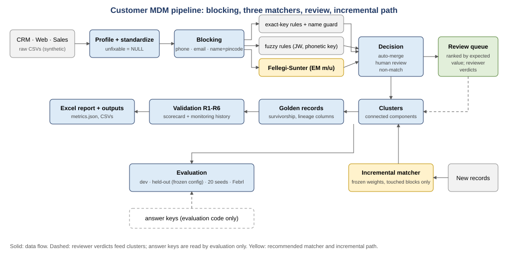
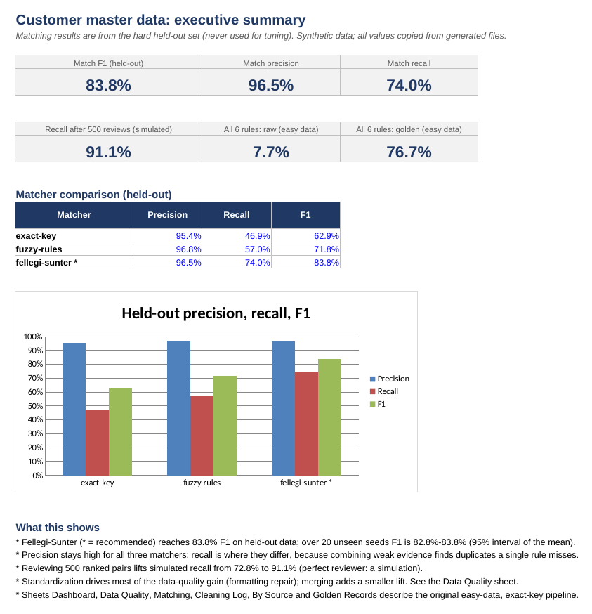
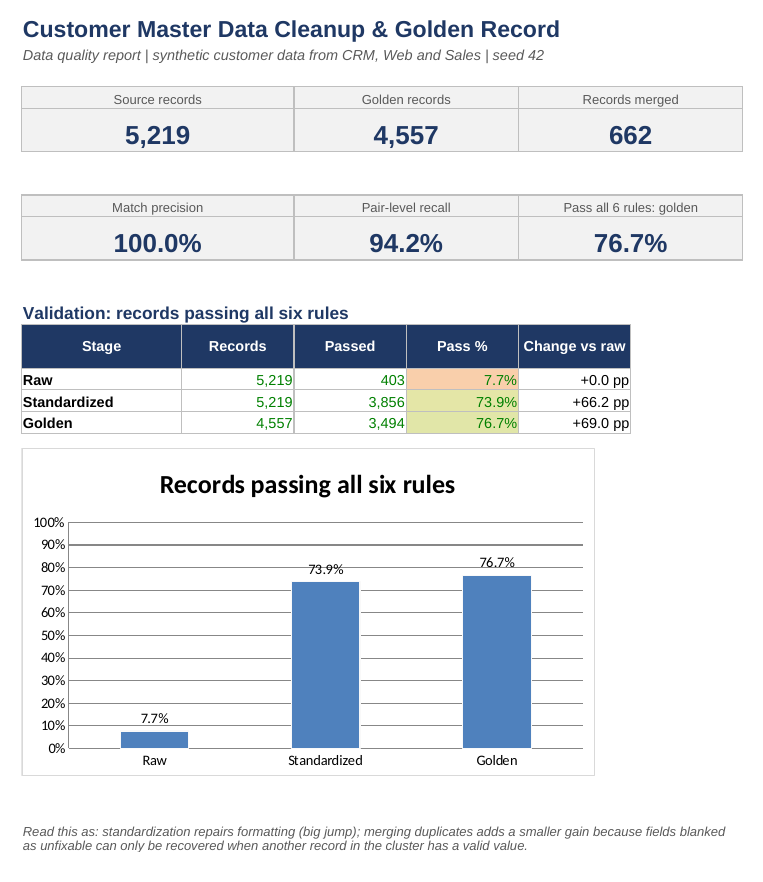
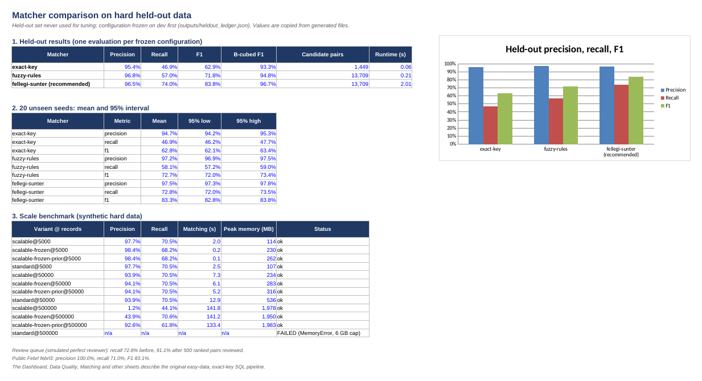
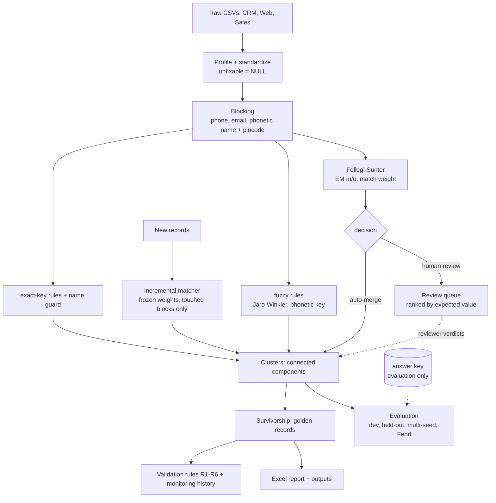
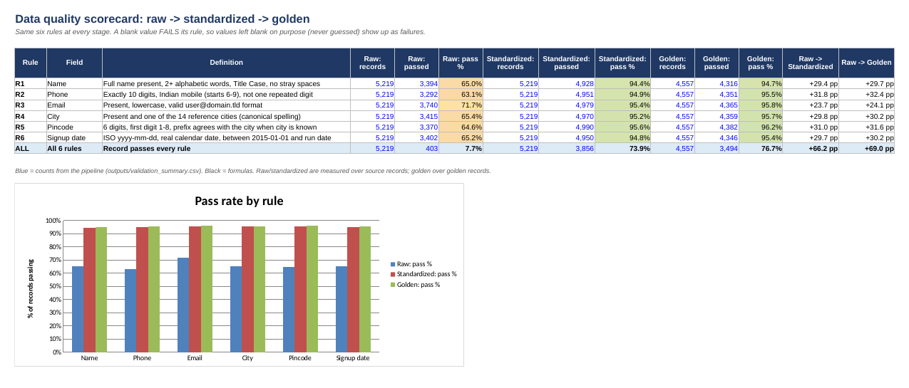

# Customer Master Data Cleanup & Golden Record

> An end-to-end customer master data pipeline: standardize multi-source records, match duplicates (exact-key, fuzzy and Fellegi-Sunter matchers), survive-and-merge into golden records, validate quality, and evaluate honestly on held-out data.

**Tools:** Python (pandas) · SQL (SQLite, DuckDB port) · Excel (openpyxl)  **Data:** synthetic customer records from 3 source systems (CRM, Web, Sales), plus the public Febrl benchmark

## At a glance

- **Problem:** the same customer sits in a CRM, a website and a sales tool with different formats, typos and gaps, so customer counts are inflated and no record can be trusted.
- **Approach:** standardize six fields (blank beats a wrong guess), match duplicates with three matchers (exact-key, fuzzy, Fellegi-Sunter), merge into golden records with explicit survivorship rules, and score quality with six validation rules.
- **Credible result:** on a hard held-out set the matcher was never tuned on, Fellegi-Sunter reaches **96.5% precision, 74.0% recall, 83.8% F1** (exact-key rules: 62.9% F1).
- **Data quality:** on the easy dataset, records passing all six rules go from **7.7% raw to 76.7% golden**; most of the gain is standardization, merging adds about 3 pp like-for-like.
- **Honest caveats:** all data is synthetic from one generator (Febrl is the only external check), the review-queue gain is a simulation, and the INR business estimate uses placeholder costs.
- **Start here:** [Excel executive summary](screenshots/excel_executive_summary.png) · [matcher comparison](outputs/matcher_comparison.csv) · [limitations](docs/limitations.md) · [interview notes](docs/interview_notes.md)

## Key Results

Matching on the **hard held-out set** (5,174 records, never used for tuning; matcher configuration frozen on the dev set first, see [`outputs/heldout_ledger.json`](outputs/heldout_ledger.json)):

| Matcher | Precision | Recall | F1 | Candidate pairs |
|---|---|---|---|---|
| exact-key (original rules) | **95.4%** | **46.9%** | **62.9%** | 1,449 |
| fuzzy-rules | **96.8%** | **57.0%** | **71.8%** | 13,709 |
| **fellegi-sunter (recommended)** | **96.5%** | **74.0%** | **83.8%** | 13,709 |

Over 20 unseen seeds the Fellegi-Sunter matcher scores precision **97.3%-97.8%**, recall **72.0%-73.5%** and F1 **82.8%-83.8%** (95% intervals of the mean; [`outputs/multiseed_summary.csv`](outputs/multiseed_summary.csv)).

| Other evidence | Result |
|---|---|
| Review queue, simulated (perfect reviewer, 20 seeds) | recall **72.8%** before review, **91.1%** after 500 ranked pairs reviewed, precision **97.9%** |
| Public Febrl benchmark (febrl3) | precision **100.0%**, recall **71.0%**, F1 **83.1%** |
| Scale, 500k records, frozen weights | precision **92.6%**, recall **61.8%** with the prior-odds correction (**43.9%** / **70.6%** without it); the standard matcher hits a `MemoryError` under the benchmark's 6 GB cap (see [Scale](#scale-and-incremental-matching)) |
| Easy original dataset, exact-key SQL pipeline | 5,219 → **4,557** golden records; precision **100.0%**, recall **94.2%**, F1 **97.0%** (optimistic, see below) |
| Records passing all 6 validation rules (easy dataset) | **7.7%** raw → **73.9%** standardized → **76.7%** golden |

The first version of this project reported the last two rows only. The easy data was designed by the same person who wrote the rules, so 100% precision there says little; the hard held-out numbers are the credible ones, and they are much lower. Every number in this README is checked against generated files by `scripts/run_pipeline.py` ([`outputs/metrics.json`](outputs/metrics.json), [`outputs/headline_metrics.json`](outputs/headline_metrics.json)).

Details: [matcher comparison](outputs/matcher_comparison.csv) · [PR curve](docs/pr_curve.png) · [case studies](docs/case_studies.md) · [review queue](docs/review_queue.md) · [scale benchmark](outputs/scale_benchmark.csv) · [business impact](docs/business_impact.md) · [limitations](docs/limitations.md) · [interview notes](docs/interview_notes.md)









---

### How the record counts reconcile (easy dataset)

Record-level counts and pair-level metrics answer different questions and must not be mixed.

| Level | Quantity | Value | Source |
|---|---|---|---|
| Records | Source records | 5,219 | `data/raw/*.csv` |
| Records | True customers (answer key) | 4,517 | `data/ground_truth/answer_key.csv` |
| Records | Rows that *should* be removed (5,219 − 4,517) | 702 | answer key |
| Records | Rows the pipeline removed (5,219 − 4,557) | **662** | pipeline output |
| Records | Duplicate rows left behind (702 − 662 = 4,557 − 4,517) | 40 | derived, see `metrics.json` → `reconciliation` |
| Pairs | True duplicate pairs / pairs merged / missed | 742 / 699 / 43 | evaluation |

A 3-record customer contributes 2 removed rows but 3 pairs, which is why 742 pairs ≠ 702 rows.

## Overview

Companies usually keep customer data in several systems: a CRM, a website, a sales tool. Each system formats phone numbers, dates and cities its own way, and the same person often exists in more than one system with slightly different details.

This project simulates that situation. It takes messy customer records from three systems, repairs what can be repaired safely, finds the records that belong to the same person, and builds one trusted "golden" record per customer. It then measures how much cleaner the data became, and how accurate the duplicate detection was, using a ground-truth answer key that the pipeline never sees.

## Business Problem

- **Multiple source systems.** CRM, Web and Sales each store the same fields in different shapes.
- **Inconsistent information.** `+91 98765 43210`, `098765-43210` and `9876543210` are the same phone; `26 November 2018`, `09/01/2023` and `2024/03/13` are all dates; `BPL` and `Bhopal MP` are the same city.
- **Duplicate customers.** The same person appears 2-3 times, so customer counts are inflated and one customer can receive repeated or conflicting communication.
- **No trusted record.** Without a single golden record there is no reliable answer to "who is this customer and how do we reach them?".

## Objectives

1. Profile the raw data and quantify how messy it is.
2. Standardize six fields deterministically, leaving unfixable values blank rather than guessing.
3. Detect duplicate customers across systems with explainable matchers (rules, fuzzy, probabilistic), and avoid merging different people.
4. Build one golden record per customer using explicit survivorship rules.
5. Measure quality with six validation rules at three stages (raw → standardized → golden).
6. Measure matching accuracy honestly on held-out data the matchers were never tuned on, with intervals.
7. Report everything in an Excel workbook a manager could read.

## Dataset

**All data is synthetic** except the optional Febrl benchmark. No real people are involved.

| Set | Records | Seed | Purpose |
|---|---|---|---|
| `data/raw` (easy) | 5,219 | 42 | the original SQL pipeline and Excel report |
| `data/dev` (hard) | 5,171 | 101 | designing and tuning matchers |
| `data/heldout` (hard) | 5,174 | 202 | evaluated once per frozen configuration |
| Febrl febrl3 | 5,000 | n/a | public record-linkage benchmark (`python scripts/fetch_febrl.py`, git-ignored) |

Hard mode adds phone digit transpositions and drops, nickname and spelling variants (Rahul/Rahu, Mohammed/Mohd/Muhammad), swapped name order, typos, shared family emails and phones, recycled phone numbers, many people named alike in one city, higher blank rates, and duplicates where both phone and email changed. Each set has its own answer key. Split rules: [`data/README.md`](data/README.md).

## Tech Stack

- **Python 3.9+** with **pandas** and **numpy** for loading, profiling, matching and evaluation
- **SQL (SQLite)** for profiling, candidate generation, the exact-key rules, survivorship and the validation scorecard (window functions, CTEs, conditional aggregation); **DuckDB** (dev dependency) to verify the port
- **Excel** report built with **openpyxl** (live formulas, conditional formatting, charts)
- **matplotlib** for charts; **Streamlit** (optional, `requirements-app.txt`) for the demo app

Fellegi-Sunter and the similarity measures are implemented in this repo; there is no scikit-learn and no `splink`. The standard library's `difflib` is used for city typos.

## Project Architecture



The SQL path (profiling, exact-key matching, survivorship, scorecard) runs on SQLite and is ported to DuckDB. The probabilistic path runs in Python and shares the same standardized input.

## Data Cleaning

Across all 31,314 field values (5,219 records × 6 fields):

| Outcome | Values | Share |
|---|---|---|
| Already clean | 20,341 | 65.0% |
| Standardized (repaired) | 9,455 | 30.2% |
| Unfixable → left blank | 1,219 | 3.9% |
| Blank in the source | 299 | 1.0% |

Rules (full code in [`src/customer_master/standardizers.py`](src/customer_master/standardizers.py)):

| Field | What is fixed | What is left blank |
|---|---|---|
| Name | trim, collapse spaces, `Last, First` → `First Last`, strip titles (Mr., Dr.), Title Case | placeholders (`N/A`, `Unknown`, `customer`), names with digits or a single word |
| Phone | strip punctuation, remove `+91` / `91` / leading `0` | anything not a 10-digit mobile starting 6-9, or one repeated digit (`0000000000`) |
| Email | trim, lowercase, fix a fixed list of known domain typos (`gmail.con`, `hotmial.com`...) | missing `@`, `user@`, `test@test` |
| City | case, punctuation, a fixed alias list (Bangalore → Bengaluru), a single unambiguous near-match for typos | placeholders, anything not close to exactly one reference city |
| Pincode | trim, remove spaces/hyphens, drop Excel's `.0` | not 6 digits, starts with 0 or 9, or disagrees with the known city |
| Signup date | five explicit formats → ISO `yyyy-mm-dd` (slash dates read as `dd/mm/yyyy`) | invalid dates (`31/02/2021`), `TBD`, dates before 2015 or after the run date |

Real examples from [`data/sample/before_after_examples.csv`](data/sample/before_after_examples.csv):

| Field | Before | After |
|---|---|---|
| phone | `(+91) 9562807335` | `9562807335` |
| phone | `918478872874` | `8478872874` |
| name | `Chatterjee, Rajesh` | `Rajesh Chatterjee` |
| name | `Dr. Preeti Shinde` | `Preeti Shinde` |
| email | `ROHIT.KHANNA3311@OUTLOOK.COM` | `rohit.khanna3311@outlook.com` |
| email | `pankaj.gupta2329@rediffmail.co` | `pankaj.gupta2329@rediffmail.com` |
| city | `lucknow` | `Lucknow` |
| pincode | `440-727` | `440727` |
| date | `26 November 2018` | `2018-11-26` |
| date | `09/01/2023` | `2023-01-09` |
| phone | `1234567890` | *(blank: invalid)* |
| pincode | `11077A` | *(blank: not numeric)* |
| date | `31/02/2021` | *(blank: not a real date)* |

**Design principle:** a blank is better than a wrong value. A blank counts as a *failure* in the validation scorecard, so this choice is visible in the results rather than hidden.

## Entity Resolution

Two paths share the standardized data.

**1. Original SQL pipeline (exact-key, easy dataset).** Two records become a candidate pair when they share an exact value of phone, email, or `full_name` + `pincode` (NULL keys never match). A **name guard** accepts a pair only if surnames and first names agree (or one first name is an initial). With a blank name, the pair needs both phone and email to agree. Accepted pairs are clustered as connected components in SQL (2 passes). Result on the easy data: 699 accepted pairs, 4,557 clusters, 62 candidate pairs rejected by the name guard (the planted relatives sharing a phone). The 43 missed pairs: 35 shared a phone or email but one name was blank, 8 shared no key ([`outputs/missed_pairs_analysis.csv`](outputs/missed_pairs_analysis.csv)).

**2. Matcher family (hard data)** in [`src/customer_master/matchers/`](src/customer_master/matchers/), behind one interface, with blocking instead of an all-pairs join:

| Matcher | Idea |
|---|---|
| exact-key | the rules above |
| fuzzy-rules | Jaro-Winkler / Levenshtein name similarity and a phonetic key suited to Indian names |
| fellegi-sunter | m/u probabilities estimated by EM; a match weight per pair; auto-merge, review or non-match |

The recommended configuration was chosen on dev only, frozen, and evaluated once on held-out (the ledger stores its hash and the git commit). Held-out measures a new sample from the same generator, not a new noise model; Febrl is the one evaluation whose noise this project did not write. Where each matcher wins and fails: [`docs/methodology.md`](docs/methodology.md) and [`docs/case_studies.md`](docs/case_studies.md).

### Evaluation methodology

- **Pair level:** every pair of records the answer key says is the same customer is a true pair. Precision = TP / (TP + FP), recall = TP / (TP + FN), F1 = 2PR / (P + R).
- **Cluster level:** B-cubed precision/recall/F1 and purity ([`outputs/matcher_comparison.csv`](outputs/matcher_comparison.csv)). Pair recall over-weights 3-record customers (3 pairs vs 1 for a 2-record customer), so both views are reported.
- **PR curve** over the match-score threshold: [`docs/pr_curve.png`](docs/pr_curve.png), data in [`outputs/pr_curve_dev.csv`](outputs/pr_curve_dev.csv).
- **No leakage:** answer keys are opened only by evaluation code (`tests/test_no_leakage.py`).

### Human review queue

[`outputs/review_queue.csv`](outputs/review_queue.csv) lists review-band and blank-name candidate pairs with the evidence (fields that agree, disagree, are missing; scores), ranked by expected value. The recall-versus-pairs-reviewed curve ([`docs/review_simulation.png`](docs/review_simulation.png)) comes from a **simulated** reviewer that reads the answer key; it is not a measurement of real reviewers. See [`docs/review_queue.md`](docs/review_queue.md).

### Dashboard, review workflow and impact simulator

`make app` starts a six-section Streamlit dashboard: executive KPIs, data quality (filter by source system and field), a golden record explorer (raw, standardized and selected values, winning source and survivorship reason), matching evaluation (dev vs held-out, PR curve, error examples, plain-language business reading), a human review queue and a business impact simulator.

- **Review workflow** (`src/customer_master/review_store.py`): a reviewer chooses *merge*, *keep separate* or *needs investigation* for a queued pair and must give a reason. Decisions go to an append-only SQLite table (`data/processed/review_decisions.db`, or `$CUSTOMER_MDM_REVIEW_DB`) with record IDs, score, reviewer and UTC timestamp; triggers block updates and deletes. Verdicts are kept apart from evaluation data and are not applied to the golden records automatically.
- **Impact simulator** (`simulate_scenario` in `impact.py`): editable assumptions, output labelled as a hypothetical scenario estimate, not a verified saving. Its formulas are shown in the app.

### Scale and incremental matching

[`outputs/scale_benchmark.csv`](outputs/scale_benchmark.csv) benchmarks 5k, 50k and 500k synthetic records. Precision stays above 93% up to 50k records. At 500k the standard matcher fails with a `MemoryError` under the 6 GB cap, and the scalable variant's EM stops meaning "same customer" (precision about 1%). Fitting m/u once on a 50k extract and freezing them restores recall but gives only 43.9% precision, because the prior odds of a candidate pair fall as 1/N while the thresholds stay fixed. Raising both thresholds by log2(N / 50k) (3.3 bits at 500k) gives precision 92.6% at 61.8% recall (F1 74.1%, against 54.1% without it). The correction is derived from that argument, not tuned, and does nothing up to 50k. It is one run per size on one benchmark dataset, so there are no intervals, and recall pays for the precision. Not yet tested: whether the correction holds on a differently generated large file.

Incremental matching scores new records only against touched blocks using frozen weights; on dev the result equals a full rebuild with the same frozen weights ([`outputs/incremental_check.json`](outputs/incremental_check.json), `tests/test_incremental.py`). The SQL pipeline is ported to DuckDB and matches the SQLite outputs cell by cell ([`outputs/duckdb_verification.json`](outputs/duckdb_verification.json)); no other engine was tested.

### Business impact and monitoring

[`docs/business_impact.md`](docs/business_impact.md) turns measured rates into an INR estimate. Every business number is an explicit placeholder in [`config/assumptions.json`](config/assumptions.json), and under the defaults the net saving is negative, which the page explains. `python scripts/monitor_quality.py` appends the six rule pass rates to [`outputs/dq_history.csv`](outputs/dq_history.csv), draws [`docs/dq_history.png`](docs/dq_history.png), and exits non-zero if a rule drops more than the threshold in [`config/monitoring.json`](config/monitoring.json).

## Golden Record & Survivorship

One golden record per cluster ([`04_survivorship.sql`](sql/04_survivorship.sql), using `ROW_NUMBER() OVER (PARTITION BY golden_id ORDER BY ...)`). A non-null value always beats a null, and every non-null value is already standardized and valid.

| Field | Winning value | Tie-break / reason |
|---|---|---|
| Name | longest valid name (so `Rahul Sharma` beats `R Sharma`) | CRM > Sales > Web |
| Phone | highest-priority source | Sales > CRM > Web (confirmed at order time) |
| Email | highest-priority source | Web > CRM > Sales (customer typed it themselves) |
| City + pincode | the most complete pair from one record | CRM > Sales > Web; a missing half is filled from a sibling record **only if it agrees** with the chosen half |
| Signup date | earliest valid date | first time the customer appeared |

Source priorities are business assumptions for this synthetic setup, not facts learned from the data. Every golden record keeps `name_source`, `phone_source`, `email_source`, `address_source`, `date_source`, the merged `record_id`s, the matching rules and the lowest match confidence, so any value can be traced back. If every record in a cluster has a blank for a field, the golden value stays blank.

Example (`G00025`, from [`outputs/golden_records.csv`](outputs/golden_records.csv)): three records (CRM, Sales, Web) became one customer: name and address from CRM, phone from Sales, email from Web.

## Data Quality Validation

Same six rules, applied identically at three stages ([`common.py`](src/customer_master/common.py), scorecard in [`05_validation.sql`](sql/05_validation.sql)). A record "passes all" only if it satisfies every rule.

| Rule | Field | Raw | Standardized | Golden | Raw → Golden |
|---|---|---|---|---|---|
| R1 | Name | 65.0% | 94.4% | 94.7% | +29.7 pp |
| R2 | Phone | 63.1% | 94.9% | 95.5% | +32.4 pp |
| R3 | Email | 71.7% | 95.4% | 95.8% | +24.1 pp |
| R4 | City | 65.4% | 95.2% | 95.7% | +30.2 pp |
| R5 | Pincode | 64.6% | 95.6% | 96.2% | +31.6 pp |
| R6 | Signup date | 65.2% | 94.9% | 95.4% | +30.2 pp |
| **All 6** | | **7.7%** (403 / 5,219) | **73.9%** (3,856 / 5,219) | **76.7%** (3,494 / 4,557) | **+69.0 pp** |



### Validation results (easy dataset)

- **Standardization did most of the work:** 7.7% → 73.9% (+66.2 pp). Each field individually passed 63-72% of the time raw and 94-96% after cleaning.
- **Merging added a smaller gain:** 73.9% → 76.7% (+2.8 pp). A golden record can recover a value that was blank in one record if another record in the cluster has a valid one.
- **Why not higher:** the remaining ~23% fail only because a value was left blank on purpose. That is the cost of "never guess".
- **Matching is conservative:** no false merges, at the price of 43 missed pairs.

## Key Business Insights (easy dataset)

These come from the easy synthetic dataset and describe the pipeline's behaviour, not real customers.

1. **The raw data was almost unusable as-is.** Only 403 of 5,219 records (7.7%) passed all six rules, because about one-third of the values in *every* field needed repair (33-37% per field).
2. **Phone was the weakest raw field** (63.1% pass) and also had the most unrecoverable values (5.1% blanked, vs 3.1-4.2% for the others).
3. **No source system was clearly cleaner:** raw all-rules pass rate was 8.2% (CRM), 7.5% (Web), 7.4% (Sales).
4. **12.7% of records were redundant.** 625 golden records combine 2-3 source records (588 with two, 37 with three), covering 1,287 source records.
5. **Standardization is what makes matching possible.** Most accepted pairs (614 of 699) match on two or more keys, and phone/email only line up after formats are normalized.
6. **Contact coverage gaps remain** in the golden data: 206 golden records have no phone, 192 have no email, and 11 have neither, so those customers cannot be reached from this data alone.
7. **Single-key matches are the risky ones:** 85 accepted pairs rest on one key plus matching names (Medium confidence), which is where a human review queue would help first.

## Project Structure

```
├── README.md, Makefile, pyproject.toml, requirements*.txt, .pre-commit-config.yaml
├── scripts/run_pipeline.py          # original pipeline, then README-vs-generated-files check
├── scripts/                         # make_datasets, run_matcher_comparison, run_phase3/4/6, benchmark_scale,
│                                    # run_incremental, verify_duckdb, case_studies, monitor_quality, fetch_febrl
├── src/customer_master/             # standardizers, matching (SQL path), matchers/, blocking, similarity, phonetic,
│                                    # review, incremental, cluster_metrics, multiseed, impact, monitoring, headline
├── sql/ (+ sql/duckdb/)             # 01_data_profiling ... 05_validation
├── tests/                           # pytest suite (small in-memory fixtures, no network)
├── data/{raw,dev,heldout}/          # synthetic sets + answer keys; data/README.md explains the split
├── config/                          # assumptions.json (business), monitoring.json
├── outputs/, reports/, docs/        # generated results, Excel report, write-ups and charts
├── app/streamlit_app.py             # optional demo
└── .github/workflows/ci.yml
```

## How to Run

Requires Python 3.9+. Run every command from the repository root.

```bash
python -m venv .venv && source .venv/bin/activate
pip install -r requirements-dev.txt
make all          # lint, tests, pipeline (with README check), monitoring
make app          # dashboard at http://localhost:8501
make benchmark    # regenerates the scale benchmark (slow; 500k records takes minutes and about 2 GB)
```

| Command | What it does |
|---|---|
| `make run` | `python scripts/run_pipeline.py` (about 5 seconds; fails if the README numbers drift from the generated files) |
| `make test` | pytest with coverage summary (`outputs/coverage.txt`) |
| `make lint` | `ruff check` |
| `make benchmark` | scale benchmark at 5k, 50k, 500k |
| `make app` | Streamlit dashboard (installed by `requirements-dev.txt`) |
| `make smoke` | fast check of dashboard, review store and simulator tests |
| `make install` | installs dev and app requirements |

Dependency notes: `requirements.txt` (pandas, numpy, openpyxl, matplotlib) is the runtime; `requirements-dev.txt` includes `requirements-app.txt` (Streamlit 1.50+) and adds pytest and ruff, `pytest-cov` for coverage, and `duckdb` only to verify the SQL port; `requirements-app.txt` adds Streamlit for the optional demo.

Re-running the experiments (`scripts/run_matcher_comparison.py`, `run_phase3.py`, `run_phase4.py`) evaluates held-out data and appends to the ledger, so do that only when you intend to freeze a new configuration.

## SQL Highlights

**Window `COUNT` for duplicate candidates** ([`02_duplicate_detection.sql`](sql/02_duplicate_detection.sql)): how many records share this record's phone? NULL keys get their own partition so blanks never group together.
```sql
COUNT(*) OVER (PARTITION BY COALESCE(phone, 'nophone:' || record_id)) AS phone_group_size
```

**Match decision with `CASE`** ([`03_matching.sql`](sql/03_matching.sql)): readable confidence label and the name guard.
```sql
CASE WHEN keys_agreeing >= 2 THEN 'High' ELSE 'Medium' END AS match_confidence
...
WHERE name_status = 1
   OR (name_status = -1 AND phone_match = 1 AND email_match = 1)
```

**Survivorship with `ROW_NUMBER`** ([`04_survivorship.sql`](sql/04_survivorship.sql)): rank each cluster's records by rule, keep rank 1.
```sql
ROW_NUMBER() OVER (
    PARTITION BY m.golden_id
    ORDER BY CASE c.source_system WHEN 'Sales' THEN 1 WHEN 'CRM' THEN 2 ELSE 3 END, c.record_id) AS rn
```

**Scorecard with conditional aggregation** ([`05_validation.sql`](sql/05_validation.sql)): unpivot pass counts for three stages, then `MAX(CASE WHEN stage = ...)` to put raw / standardized / golden side by side.

## Data Quality Framework

| Rule | Field | Definition |
|---|---|---|
| R1 | Name | present, 2+ alphabetic words, Title Case, no stray spaces |
| R2 | Phone | exactly 10 digits, Indian mobile (starts 6-9), not one repeated digit |
| R3 | Email | present, lowercase, valid `user@domain.tld` |
| R4 | City | present and one of the 14 reference cities (canonical spelling) |
| R5 | Pincode | 6 digits, first digit 1-8, prefix agrees with the city when the city is known |
| R6 | Signup date | ISO `yyyy-mm-dd`, real calendar date, between 2015-01-01 and the run date (fixed at 2026-10-08) |

The rules are strict about *format*: a correct phone like `+91 98765 43210` fails R2 until it is standardized. That is deliberate (it measures the formatting problem), but it is also why the raw rate is so low.

## Limitations

Summary; the full list, including what the upgrade addressed, is in [`docs/limitations.md`](docs/limitations.md).

- **Synthetic data.** Dev, held-out and the 20 seeds share one generator. Febrl is the only external check.
- **Scale.** At 500k records the prior-odds correction gives 92.6% precision but only 61.8% recall, from one run per size without intervals, and the standard matcher hits a `MemoryError` under the 6 GB benchmark cap.
- **The review result is a simulation** (perfect reviewer for the 20-seed curve).
- **The business estimate uses placeholder costs.**
- **Some Excel sheets (Dashboard, Data Quality, Matching) describe the easy-data, exact-key pipeline.** The Executive Summary and Matcher Comparison sheets carry the held-out results.
- **Validation lift on the easy data, like-for-like:** standardized records scored per cluster pass all rules 73.6% of the time against 76.7% for golden records, a **3.1 pp** merge lift, smaller than the headline gap suggests. The raw rules are format-strict, which inflates the raw → standardized gain.
- **Survivorship priorities are assumptions** (for example Sales > CRM > Web for phone).

## Documentation

[`docs/methodology.md`](docs/methodology.md) · [`docs/data_dictionary.md`](docs/data_dictionary.md) · [`docs/case_studies.md`](docs/case_studies.md) · [`docs/review_queue.md`](docs/review_queue.md) · [`docs/business_impact.md`](docs/business_impact.md) · [`docs/limitations.md`](docs/limitations.md) · [`docs/interview_notes.md`](docs/interview_notes.md) · [`data/README.md`](data/README.md) · [`outputs/README.md`](outputs/README.md)

## License

MIT, see [`LICENSE`](LICENSE).

## Author

Umangkr-DA. Data analytics portfolio project. All data is synthetic; no real customers are involved. Handling real customer identifiers would require access controls and privacy review that this project does not implement.
